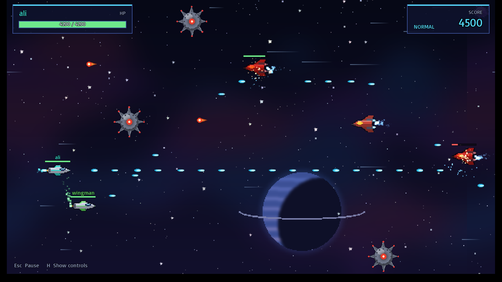
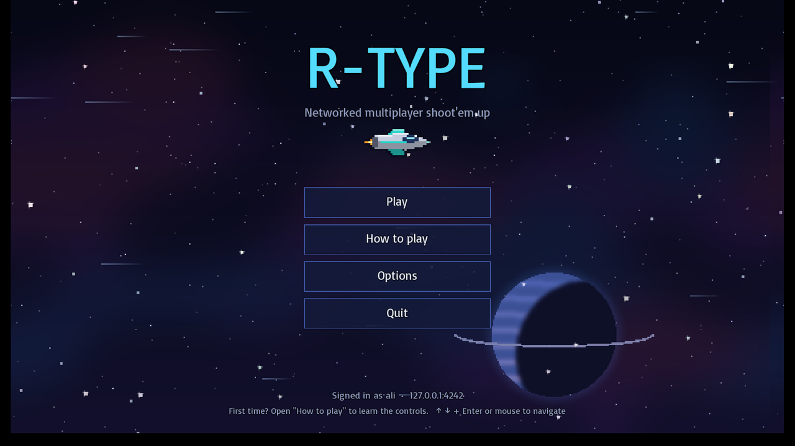
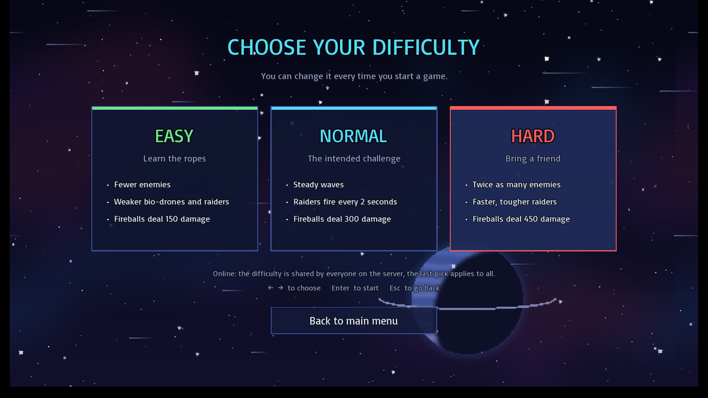
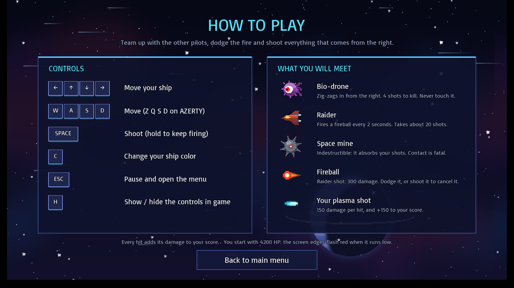
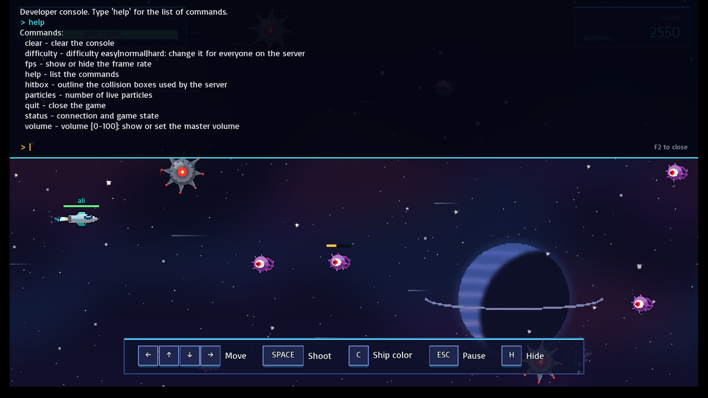

# R-Type — Networked Multiplayer Game Engine

A from-scratch C++20 game engine and multiplayer shoot'em up inspired by the classic *R-Type*: an authoritative UDP server, an Entity-Component-System shared by client and server, and runtime-loadable modules (graphics, sound, particles, animation, console).

> Team project (3 developers), 3rd year at Epitech. See [My contribution](#my-contribution).



| Main menu | Difficulty | How to play |
| --- | --- | --- |
|  |  |  |

## Highlights

- **Client / server architecture** over a custom binary **UDP protocol** (Asio): server session manager, client network thread feeding a message queue to the game loop
- **Authoritative server game loop** at a fixed 60 ticks/s: movement, collisions, damage and score are resolved on the server, then each player receives its updates at its own address once per tick
- **Entity-Component-System** with an entity manager and component abstraction, plus an abstract factory for game entities
- **Pluggable engine modules** loaded and unloaded while the game runs (`IModule`, `ModuleLoader`, `ModuleProvider`): graphics, animation, **sound** (effects and music), **particles** (explosions, sparks, engine trails) and a **developer console**
- **Co-op gameplay** for up to 4 players: bio-drones, raiders that shoot back, space mines, three **difficulty levels**, health, score and a game-over screen
- **State-driven client UI**: login, menu, difficulty choice, how-to-play guide, options, game HUD, pause and game-over views with reusable widgets (buttons, key caps, text/number inputs, switches), all usable with mouse or keyboard
- Tooling: CMake + vcpkg, clang-format / clang-tidy, Doxygen documentation

## Architecture

```
engine/   Shared core: ECS, networking (UDPAdapter, NetworkMessage), module system, thread-safe tools
server/   Authoritative game server: UDPServer, SessionManager, GameLogic, EntityFactory
client/   Game client: UDPClient, view states, graphical entities, UI components, resource manager
tests/    GoogleTest unit tests for the ECS and engine tools (no SFML needed)
docs/     Protocol, packet format and ECS documentation
```

Design docs: [UDP protocol](docs/udpProtocol.md) · [Packet format](docs/packet.md) · [ECS](docs/ecs.md)

## Supported platforms

| OS | Status |
| --- | --- |
| Linux: Ubuntu / Debian, Arch, Fedora (x86-64) | Supported: `install.sh` and `play.sh`. CI builds and tests on Ubuntu 24.04 |
| Windows 10 / 11 (x64) | Supported: `install.ps1` and `play.ps1`, built with Visual Studio 2022. CI builds and tests on Windows Server 2022 |
| macOS | Not supported (never built or tested) |

Players on Linux and Windows can play together: the client and the server speak the same UDP protocol.

## Requirements

**Linux**

- A C++20 compiler: GCC 10+ or Clang 12+ (Ubuntu 22.04 and later are fine)
- CMake 3.16+ (if it is missing, `install.sh` uses the one vcpkg downloads)
- `git`, `curl`, `zip`, `unzip`, `tar`, `pkg-config`, and the X11, OpenGL and udev development packages that SFML needs: `./install.sh --deps` installs them all (list below)
- `sudo` rights, only for `--deps`

**Windows**

- Visual Studio 2022 or its free [Build Tools](https://visualstudio.microsoft.com/downloads/#build-tools-for-visual-studio-2022), with the **Desktop development with C++** workload (it includes CMake)
- [Git for Windows](https://git-scm.com/download/win)
- PowerShell 5.1 (built into Windows) or PowerShell 7

```powershell
winget install Git.Git
winget install Microsoft.VisualStudio.2022.BuildTools --override "--add Microsoft.VisualStudio.Workload.VCTools --includeRecommended --passive"
```

**Both**

- An internet connection for the first build: [vcpkg](https://vcpkg.io) downloads and compiles SFML 2.6 and Asio 1.32 (about 2 GB of disk with the build)
- A graphics card or driver with OpenGL, a screen and a keyboard; speakers for the sound module (optional)
- To play over a network: UDP port **4242** (or the one you choose) reachable on the server machine; allow it in the firewall (Windows asks the first time the server starts)
- Optional: Python 3 to run the multiplayer integration test, and Pillow (`pip install Pillow`) to regenerate the assets

## Install

The install script checks the tools, sets up vcpkg (it reuses `$VCPKG_ROOT` or `~/vcpkg` if you have one, otherwise clones it into `./vcpkg`), then builds the server, the client and the engine modules into `build/out`.

**Linux**

```bash
git clone https://github.com/alir961/r-type-game-engine.git
cd r-type-game-engine
./install.sh --deps     # installs the system packages with sudo (apt, pacman or dnf), then builds
```

Already have the packages? Just run `./install.sh`. If something is missing, it lists it and prints the command for your distribution.

<details>
<summary>System packages installed by <code>--deps</code></summary>

| Distribution | Packages |
| --- | --- |
| Ubuntu / Debian | `build-essential git curl zip unzip tar pkg-config cmake libx11-dev libxrandr-dev libxcursor-dev libxi-dev libudev-dev libgl1-mesa-dev` |
| Arch | `base-devel git curl zip unzip tar pkgconf cmake libx11 libxrandr libxcursor libxi systemd-libs mesa` |
| Fedora | `gcc-c++ make git curl zip unzip tar pkgconf cmake libX11-devel libXrandr-devel libXcursor-devel libXi-devel systemd-devel mesa-libGL-devel` |

</details>

**Windows** (PowerShell)

```powershell
git clone https://github.com/alir961/r-type-game-engine.git
cd r-type-game-engine
powershell -ExecutionPolicy Bypass -File .\install.ps1
```

`-ExecutionPolicy Bypass` lets this one script run on a machine that blocks downloaded scripts; with scripts already allowed, `.\install.ps1` is enough. It builds in Release with the vcpkg triplet in `triplets/x64-windows-static-md-release.cmake` (SFML linked statically, as on Linux), so the game needs no extra DLLs.

The first build compiles SFML and its dependencies, so it takes a few minutes (10 to 20 on Windows); later builds are incremental. Re-run the install script after pulling changes.

## Launch

`play.sh` (Linux) and `play.ps1` (Windows) start the server and the client for you, from any directory:

| Linux | Windows | What it starts |
| --- | --- | --- |
| `./play.sh` | `.\play.ps1` | A local server and one client: solo game |
| `./play.sh 2` | `.\play.ps1 2` | A local server and two clients: multiplayer on one screen (up to 4) |
| `./play.sh server [port] [easy\|normal\|hard]` | `.\play.ps1 server [port] [easy\|normal\|hard]` | Only the server, so others can join (default `4242`, `normal`; Ctrl+C to stop) |
| `./play.sh client` | `.\play.ps1 client` | Only a client, to join a server running elsewhere |

On the login screen, type a username and press **Enter**. The server address defaults to `127.0.0.1:4242`, which is right for a local game. To join a friend, enter the IP of the machine running the server and its port. In a local game the server stops when you close the last game window; its log is in `build/server.log`.

<details>
<summary>Running the binaries by hand</summary>

Run them from the repository root: the client loads its engine modules from `build/out/engine/modules/` and its sprites from `client/assets/`.

```bash
./build/out/server/r-type_server 4242 [easy|normal|hard]   # UDP port to listen on (Windows: r-type_server.exe)
./build/out/client/r-type_client                           # in another terminal, once per player
```

To build without the scripts, configure with the vcpkg toolchain: `cmake -S . -B build/out -DCMAKE_BUILD_TYPE=Release -DCMAKE_TOOLCHAIN_FILE=<vcpkg>/scripts/buildsystems/vcpkg.cmake` (on Windows add `-DVCPKG_OVERLAY_TRIPLETS=triplets -DVCPKG_TARGET_TRIPLET=x64-windows-static-md-release`), then `cmake --build build/out --config Release`.

</details>

## How to play

| Keys | Action |
| --- | --- |
| Arrow keys / WASD (ZQSD on AZERTY) | Move |
| Space (hold) | Shoot |
| C | Change ship color |
| Esc | Pause menu |
| H | Show / hide the in-game controls bar |

Menus work with the mouse or with ↑/↓ and Enter. The **How to play** screen (main menu and pause menu) lists the controls and the enemies: bio-drones, raiders that fire fireballs, and indestructible space mines. Every hit adds its damage to your score; touching an enemy or a mine destroys your ship. Co-op players pass through each other and their shots don't hurt teammates.

### Difficulty

**Play** asks for a difficulty. The server owns the rules, so the level applies to everyone connected to it (the last pick wins), and the HUD shows the current one.

| | Easy | Normal | Hard |
| --- | --- | --- | --- |
| New bio-drone every | 4.5 s | 3 s | 1.5 s |
| New raider every | 7 s | 4 s | 2.5 s |
| Raiders fire every | 3 s | 2 s | 1.2 s |
| Fireball damage | 150 | 300 | 450 |
| Bio-drone / raider health | 300 / 1800 | 500 / 3000 | 650 / 4000 |

### Modules and developer console

Sound, particles and the console are engine modules (`.so` files on Linux, `.dll` on Windows) that **Options** switches on and off while you play; the game keeps running without them, and each switch takes effect immediately:

| Module | What it adds |
| --- | --- |
| Sound | Background music (quieter in the menus) and effects for shots, hits, explosions, menus and game over |
| Particle | Explosions, hit sparks and engine trails behind every ship |
| Console | The developer console below |

The console is a debugging tool rather than part of the gameplay: it shows what the server sees (`hitbox` draws the real collision boxes), measures performance (`fps`, `status`) and changes settings without leaving the game. Press **F2** (or `` ` ``) on any screen to open it:

| Command | Effect |
| --- | --- |
| `help` | List the commands |
| `fps` | Show the frame rate |
| `hitbox` | Outline the collision boxes the server uses |
| `volume [0-100]` | Show or set the master volume |
| `difficulty easy\|normal\|hard` | Change the difficulty for the whole server |
| `particles` / `status` | Live particle count / connection and game state |
| `clear`, `quit` | Clear the console / close the game |



## Assets

Sprites, parallax backgrounds, sound effects and the music loop are original and generated by [`tools/generate_assets.py`](tools/generate_assets.py) (Pillow and the Python standard library). Frame sizes match the collision rectangles the server sends, so re-run the script after changing either:

```bash
python3 tools/generate_assets.py
```

## Tests

The engine core has unit tests (ECS components, entity manager, thread-safe queue, string and number utilities). They build on their own, without SFML or vcpkg, but need CMake 3.20+ and an internet connection (CMake downloads GoogleTest):

```bash
cmake -S tests -B build/tests
cmake --build build/tests
ctest --test-dir build/tests --output-on-failure     # Windows (Visual Studio): add -C Debug
```

No CMake on your PATH? `install.sh` uses vcpkg's: `CMAKE=$(~/vcpkg/vcpkg fetch cmake | tail -n 1)`, then `"$CMAKE"` and `"$(dirname "$CMAKE")/ctest"` in place of `cmake` and `ctest`.

The multiplayer integration test starts a server and plays two headless clients over the real UDP protocol (Python 3, standard library only):

```bash
python3 tests/integration/multiplayer_test.py build/out/server/r-type_server
```

CI builds the game on Linux and Windows and runs both test suites on every push.

## My contribution

Top contributor of the 3-person team: 120 of the 282 commits made during the project (Nov 2023 – Jan 2024). Measured with `git blame`, I wrote most of the ECS, the client views and the UI components.

**During the project**

- **Entity-Component-System**: started as an abstract entity factory, then refactored into the entity / component / entity-manager design used by both server and client (component types, `hasComponent`, base-component checks, size component)
- **Client view-state system**: login, loading, menu, options, game, pause and death screens, switching between them, and the **UI component library** (text and number inputs, buttons, checkboxes)
- **Runtime module loading / unloading** from the options screen, plus the first console and particle modules
- **Graphical module API** (`drawText`, `drawSprite`, `drawRect`) together with Timothé, and the graphic-entity factory with a resource manager for textures and audio
- **Client gameplay features**: player / enemy concepts, shooting, player names above ships, real health and score display, connection error handling (wrong port, server down)
- **CI and tooling**: the GitHub Actions build and release jobs, Windows build support in CMake, and the Doxygen documentation

**Later, for this portfolio version (2026)**

- **Tests and CI**: engine unit tests (GoogleTest, no SFML needed) and a headless **multiplayer integration test** that plays two clients over the real UDP protocol; CI builds the game and runs both on every push
- **Visual and UX overhaul**: original procedurally generated pixel art (`tools/generate_assets.py`), per-entity animations (they used to share state), a redesigned keyboard- and mouse-friendly UI, an in-game HUD, a **How to play** guide and explosions
- **Multiplayer networking fix**: the server sent every update to whichever client spoke last, so with two players each one lost most of its own ship's updates. It now keeps one address per player, flushes each player's queue once per tick from a fixed-rate loop, and locks the game state shared by the network and game threads. Every player now gets its own ship at 60 updates/s, with 4 players, using under 20% of one CPU core.
- **Working sound, particle and console modules** (they were stubs): generated music and sound effects, explosions, sparks and engine trails, and a developer console (hitboxes, FPS, live settings). Plus three **difficulty levels**, and gameplay fixes: ships no longer die at the screen edges, co-op players no longer kill each other, shots leave from the nose, and mouse coordinates, port input and connection-cancel bugs are fixed
- **One-command install and launch** (`install.sh`, `play.sh`), with the dependency pins fixed so it builds on current compilers
- **Native Windows build** (MSVC, vcpkg, `install.ps1` and `play.ps1`): one module loader for `dlopen` and `LoadLibrary`, portable alignment and escapes, and a Windows CI job

The networking layer, the authoritative server (session manager, game logic, compression) and the module loader were mainly written by Joan Thomas and Timothé Medico.

## Team

Ali Raad · Joan Thomas · Timothé Medico
